[English](./README.md) | **简体中文**

<div align="center">


# QuantProof

**给本地 LLM 开发者的基准工具：在你自己的任务上给量化档位排名。**

公开的量化对比表排的是别人任务上的名次。QuantProof 把同一个模型的每个量化档位跑一遍*你的*任务包，直接显示质量在你的负载上哪里坍缩——不用再花一个周末和 40 GB 下载去手动验证。

[](https://github.com/SuperMarioYL/quantproof/actions/workflows/ci.yml)
[](https://github.com/SuperMarioYL/quantproof/releases)
[](https://www.python.org/)
[](./LICENSE)


<picture>
  <source media="(max-width: 640px) and (prefers-color-scheme: dark)" srcset="assets/presentation/hero-mobile-dark.svg">
  <source media="(max-width: 640px)" srcset="assets/presentation/hero-mobile-light.svg">
  <source media="(prefers-color-scheme: dark)" srcset="assets/presentation/hero-dark.svg">
  
</picture>

</div>

---

##  快速开始

前置条件：Python 3.12+；真实运行还需要 PATH 里有 [llama.cpp](https://github.com/ggml-org/llama.cpp) 的 `llama-server`（下面的 stub 示例没有它也能跑）。从源码安装：

```bash
git clone https://github.com/SuperMarioYL/quantproof.git
cd quantproof
python3 -m venv .venv && source .venv/bin/activate
python -m pip install -e .
```

生成内置示例任务包——10 道题，零编写成本：

```bash
quantproof init
```

不需要模型，先跑通完整流水线（使用 `tests/` 下的确定性 stub 服务）：

```bash
printf '(stub)' > Q4_K_M.demo.gguf && printf '(stub)' > IQ2_XXS.demo.gguf && \
  quantproof rank --gguf Q4_K_M.demo.gguf IQ2_XXS.demo.gguf --tasks ./tasks \
  --server-bin "python3 tests/stub_llama_server.py"
```

用你已有的 GGUF 真实运行：

```bash
quantproof rank --gguf model.Q4_K_M.gguf model.IQ2_XXS.gguf --tasks ./tasks
```

这就是全部流程：一次一条命令，每个档位一个 `llama-server` 子进程，结束时输出排名表。真实运行前可先跑 `quantproof doctor`，它会检查 `llama-server` 是否在 PATH 上并报告 GPU 可见性，缺失时给出安装提示。

##  运行记录

下面的命令与输出逐字复制自 `0.1.0` 的真实运行——完整记录见 [docs/demo-results.json](docs/demo-results.json)，叙事版说明见 [docs/demo-report.md](docs/demo-report.md)。录制机器上没有安装 llama-server，因此 rank 步骤通过 `--server-bin` 换成了确定性 stub 服务：进程管理、`/health` 等待、采样、两种判分器和坍缩差值表都是真实代码路径，但通过率展示的是流水线机制，不代表量化质量。

```text
QuantProof — 10 tasks x k=3 per variant, base model: Qwen/Qwen3.8-27B
        Quant calibration — ranked on your tasks
┏━━━━━━━━━┳━━━━━━━━━━━┳━━━━━━━━━━━┳━━━━━━━━┳━━━━━━━━━━━┓
┃ Variant ┃ Pass rate ┃ Δ vs best ┃  tok/s ┃ Size (GB) ┃
┡━━━━━━━━━╇━━━━━━━━━━━╇━━━━━━━━━━━╇━━━━━━━━╇━━━━━━━━━━━┩
│ Q4_K_M  │    100.0% │  baseline │ 9673.7 │      0.00 │
│ IQ2_XXS │     60.0% │  -40.0 pp │ 8702.7 │      0.00 │
└─────────┴───────────┴───────────┴────────┴───────────┘
collapse: IQ2_XXS (-40.0 pp) versus Q4_K_M on your tasks
```

同一次运行的逐任务矩阵显示劣化*落在哪里*——stub 的坍缩模式让 c-01、c-02、c-03 和 qa-01 掉到 0/3，其余保持：

```text
Per-task pass rate (passed samples / k)
┏━━━━━━━┳━━━━━━━━━━━┳━━━━━━━━┳━━━━━━━━━┓
┃ Task  ┃ Grader    ┃ Q4_K_M ┃ IQ2_XXS ┃
┡━━━━━━━╇━━━━━━━━━━━╇━━━━━━━━╇━━━━━━━━━┩
│ c-01  │ codeblock │  3/3   │   0/3   │
│ c-02  │ codeblock │  3/3   │   0/3   │
│ c-03  │ codeblock │  3/3   │   0/3   │
│ c-04  │ codeblock │  3/3   │   3/3   │
│ c-05  │ codeblock │  3/3   │   3/3   │
│ qa-01 │ contains  │  3/3   │   0/3   │
│ qa-02 │ contains  │  3/3   │   3/3   │
│ qa-03 │ contains  │  3/3   │   3/3   │
│ qa-04 │ contains  │  3/3   │   3/3   │
│ qa-05 │ contains  │  3/3   │   3/3   │
└───────┴───────────┴────────┴─────────┘
```

stub 的应答只需约一毫秒，所以它的 `tok/s` 数字没有意义；真实运行中它是服务端 token 统计给出的解码速度。从全新克隆按上面快速开始的命令即可复现这份记录。

##  为什么需要 QuantProof

一个热门开源权重发布，几天内就会长出 20 多个社区量化版本——下载只要一次点击，判断却要一天 GPU 时间。16 GB 显卡装不下大档位，只能退到坍缩差异最大的 1–4 bit 区间。而社区对"该用哪个量化"的回答，都是别人的测量：

- **公开对比表**能告诉你 4-bit 大体守得住、1-bit 会塌——但它们测的是作者的任务，不是你的，而且每个版本发布都要人工重测一次。
- **llama-bench** 测的是便宜且可迁移的指标：每个文件的解码速度和困惑度。通用文本上的困惑度预测不了一个 1-bit 档位还能不能为*这个*负载写出合法的 C 代码。
- **lm-evaluation-harness** 跑的是固定公开套件，它的全部价值在于横向可比——这恰恰与按负载校准相反。

真正需要答案的人一直在手动付这笔账：r/LocalLLaMA 有用户在 RTX 5080 上用自己的 C 代码测了同一个模型的 21 个档位；另一位花 11 天、约 167 GPU 小时对比 8 个社区版本。QuantProof 把这个循环自动化，并交给你：

- 核心原语是**坍缩差值（collapse delta）**：在可迁移、归你所有的任务包上测出的每档位质量分，表达为相对最优档位的差距。`IQ2_XXS: -40.0 pp on your tasks` 是任何博客表格都印不出来的那一行。
- 判分是**确定性的**：代码用你自己的 shell 测试命令，问答用精确子串。同一个任务包，每次重跑结论一致——没有 LLM 裁判的漂移。
- 核心**从第一天起就与模型无关**：任意 GGUF 文件、任意量化作者，因为任务包和判分器从不假设模型。

##  工作原理

一个 CLI 进程，状态在磁盘，没有守护进程、没有数据库、没有遥测。任意时刻最多两个进程活着：CLI 本身和一个 `llama-server` 子进程。

```
tasks.json ──┐
 *.gguf ─────┼─▶ resolve ─▶ runner ──▶ llama-server -m <gguf> :8111
             │                │              │  /health, then k samples per task
             │                ▼              ▼
             │            grader ◀── /v1/chat/completions
             │                │  code block -> temp dir -> test_cmd (exit 0 = pass)
             │                │  or exact substring for QA
             │                ▼
             └──────────── report: score, tok/s, per-task rates
                           -> ranked table + collapse deltas vs the best variant
```

<picture>
  <source media="(max-width: 640px) and (prefers-color-scheme: dark)" srcset="assets/presentation/architecture-mobile-dark.svg">
  <source media="(max-width: 640px)" srcset="assets/presentation/architecture-mobile-light.svg">
  <source media="(prefers-color-scheme: dark)" srcset="assets/presentation/architecture-dark.svg">
  
</picture>

驱动整夜无人值守运行的校准循环：

<picture>
  <source media="(max-width: 640px) and (prefers-color-scheme: dark)" srcset="assets/presentation/process-mobile-dark.svg">
  <source media="(max-width: 640px)" srcset="assets/presentation/process-mobile-light.svg">
  <source media="(prefers-color-scheme: dark)" srcset="assets/presentation/process-dark.svg">
  
</picture>

##  任务包

任务包就是一个包含 `tasks.json` 的目录——归你所有、可版本化、可分享的纯数据。`quantproof init` 会用内置的 10 题示例包生成一份；两个示例包也单独随仓库发布：

| 任务包 | 任务 | 判分器 |
| --- | --- | --- |
| [examples/c-coding](examples/c-coding/tasks.json) | 5 道 C 程序题（素数、fizzbuzz、求和、字符串反转、斐波那契） | `codeblock`——用 `cc` 编译、运行、与期望输出 `diff` |
| [examples/general-qa](examples/general-qa/tasks.json) | 5 道简短事实问答 | `contains`——回复中出现精确子串 |
| 内置包（`quantproof init`） | 以上全部，10 道题 | 混合 |

Schema：

```json
{
  "base_model": "Qwen/Qwen3.8-27B",
  "k_samples": 3,
  "tasks": [
    {
      "id": "c-01",
      "prompt": "Write a complete C program ... Reply with the program in one fenced code block.",
      "grader": {
        "type": "codeblock",
        "test_cmd": "cc -o prog main.c && ./prog > out.txt && printf '2\\n3\\n5\\n...' | diff - out.txt",
        "filename": "main.c",
        "timeout_s": 60
      }
    },
    {
      "id": "qa-01",
      "prompt": "What is the capital of France? Reply with just the city name.",
      "grader": { "type": "contains", "expected": "Paris" }
    }
  ]
}
```

`codeblock` 把回复中的**第一个代码块**写进隔离临时目录的 `filename`，并在那里执行 `test_cmd`；退出码 0 即通过。`contains` 要求 `expected` 以精确子串出现。任务包会执行你写的 shell 命令——信任级别与你的 CI 脚本相同。`base_model` 仅作记录（标明这些档位属于哪个模型），`k_samples` 是每个任务每档位的采样次数。

##  命令行

| 命令 | 作用 |
| --- | --- |
| `quantproof doctor` | 检查 `llama-server` 是否在 PATH 上并报告 GPU 可见性；缺失时打印安装提示 |
| `quantproof init` | 用内置 10 题示例包生成 `./tasks` |
| `quantproof rank` | 对每个 `--gguf` 档位跑任务包并打印排名表 |

`rank` 选项：

| 选项 | 默认值 | 说明 |
| --- | --- | --- |
| `--gguf` | 必填 | 本地 GGUF 文件；每个档位传一次，也可以一个旗标后空格连传多个 |
| `--tasks` | 必填 | 任务包目录（或其 `tasks.json`） |
| `--k` | 任务包值 | 覆盖每任务采样次数 |
| `--port` | `8111` | `llama-server` 子进程端口 |
| `--startup-timeout` | `600` | 等待 `/health` 的秒数（大模型加载慢） |
| `--server-bin` | `llama-server` | 进阶：llama-server 兼容命令（包装器、容器封装或测试 stub） |

档位标签从文件名解析（`Model-27B.Q4_K_M.gguf` → `Q4_K_M`）；识别不出量化标签的文件回退用文件名主干。单个采样出错只记为失败、运行继续——整夜扫描不会因一次抖动而中断。

##  能力与集成

<picture>
  <source media="(max-width: 640px) and (prefers-color-scheme: dark)" srcset="assets/presentation/integrations-mobile-dark.svg">
  <source media="(max-width: 640px)" srcset="assets/presentation/integrations-mobile-light.svg">
  <source media="(prefers-color-scheme: dark)" srcset="assets/presentation/integrations-dark.svg">
  
</picture>

| 组件 | 当前支持 |
| --- | --- |
| 档位来源 | 本地 `.gguf` 文件，任意模型、任意量化作者；标签从文件名解析 |
| 后端 | 仅 llama.cpp `llama-server`，走其 OpenAI 兼容的 `/v1/chat/completions` |
| 代码判分 | 你自己的 shell 测试命令（`cc`、`diff`、`grep`、pytest……），在隔离临时目录执行 |
| 问答判分 | 精确子串检查 |
| 输出 | rich 排名表（含坍缩差值）与逐任务矩阵 |
| 示例包 | `examples/` 下的 C 编码与通用问答包，`init` 内置 10 题包 |

##  配置与边界

- **v0.1 只用磁盘上已有的 GGUF 文件。** 从 GGUF 仓库下载档位（`--gguf-repo` / `--quants`）属于 m2，尚未实现；`HF_ENDPOINT` 镜像支持也随之一并到来。在那之前 QuantProof 本身零网络请求。
- **仅支持 llama.cpp。** v0.1 没有 Ollama、vLLM 或 transformers 后端；任务包与报告格式与后端无关，其他后端属于路线图。
- **仅确定性判分。** 不用 LLM 裁判；同一任务包重跑结论一致（模型采样本身除外——k 次采样正是为了测量这个方差）。
- **仅终端报告。** 可 gist 的 `report.md` / `results.json` 产物和断点续跑属于 m2。
- **坍缩标记阈值**：比最优档位低超过 10 个百分点的档位会在表格下方单独点名。

##  路线图

- [x] **v0.1（当前，m1）**——任务包 schema、两种判分器、llama-server 编排、带坍缩差值与逐任务矩阵的排名表、`init` + `doctor`
- [ ] **m2**——按 GGUF 仓库解析量化名并自动下载档位（支持 `HF_ENDPOINT` 镜像）；断点续跑；可 gist 的 `results.json` + `report.md`
- [ ] **m3**——一小时内跑完的三档位快速模式作为默认首次运行，附真实 GPU 演示录制

v0.1 不做：Web 界面或托管榜单、llama.cpp 之外的后端、LLM 裁判判分、生成或调优量化（本工具只排名、不生成）、多 GPU 或多机运行、任何形式的账号与遥测。

##  开发与许可

```bash
python -m pip install -e ".[test]"
python -m pytest
```

测试套件覆盖任务包加载与校验、两种判分器、评分与坍缩差值计算、表格渲染，以及针对 [tests/stub_llama_server.py](tests/stub_llama_server.py) stub 服务的 llama-server 编排——不需要 GPU 或模型。演示图形用 `python3 docs/render_presentation.py --repo .` 重新生成。

[MIT](./LICENSE) © 2026 SuperMarioYL

---

<p align="center"><sub><a href="./LICENSE">MIT</a> © 2026 SuperMarioYL</sub></p>
